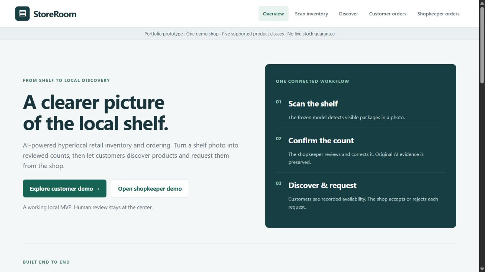
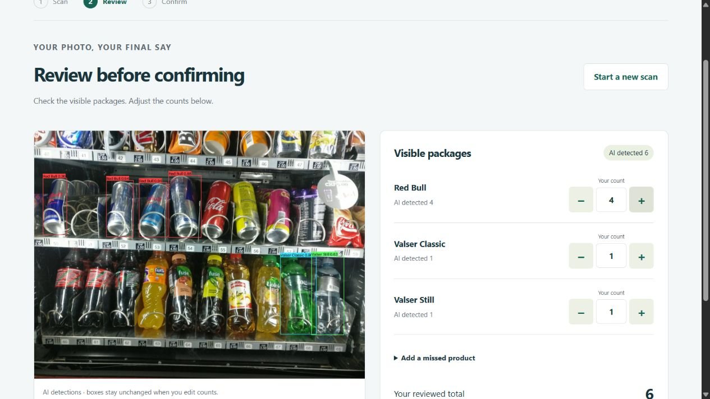
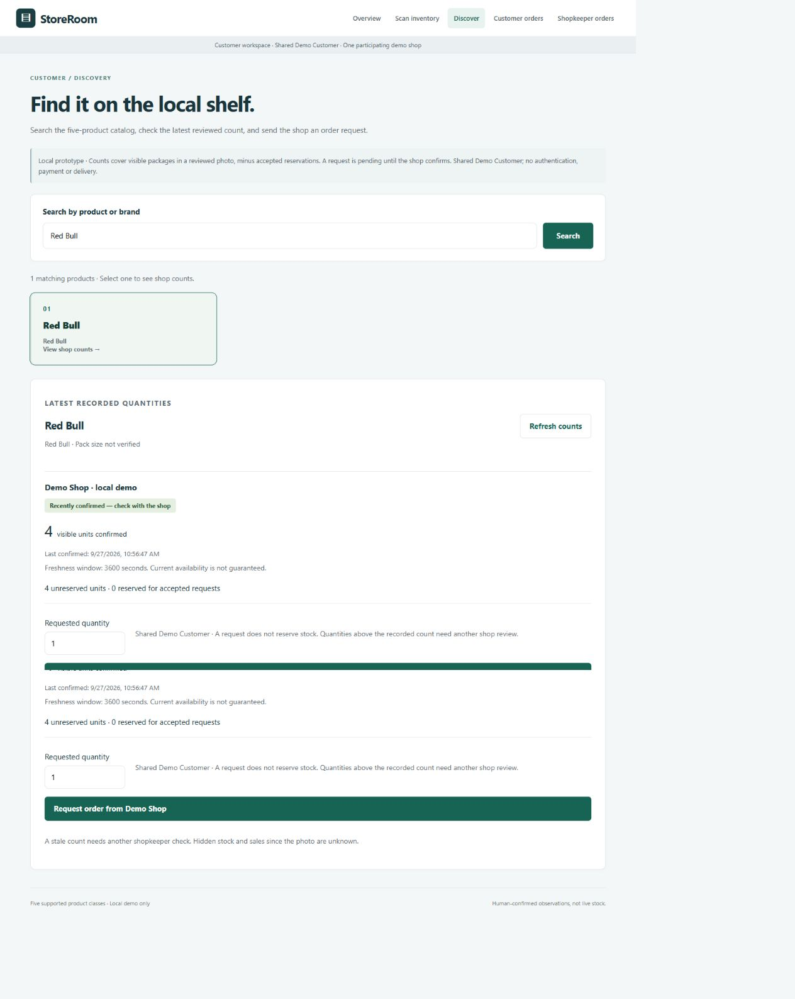
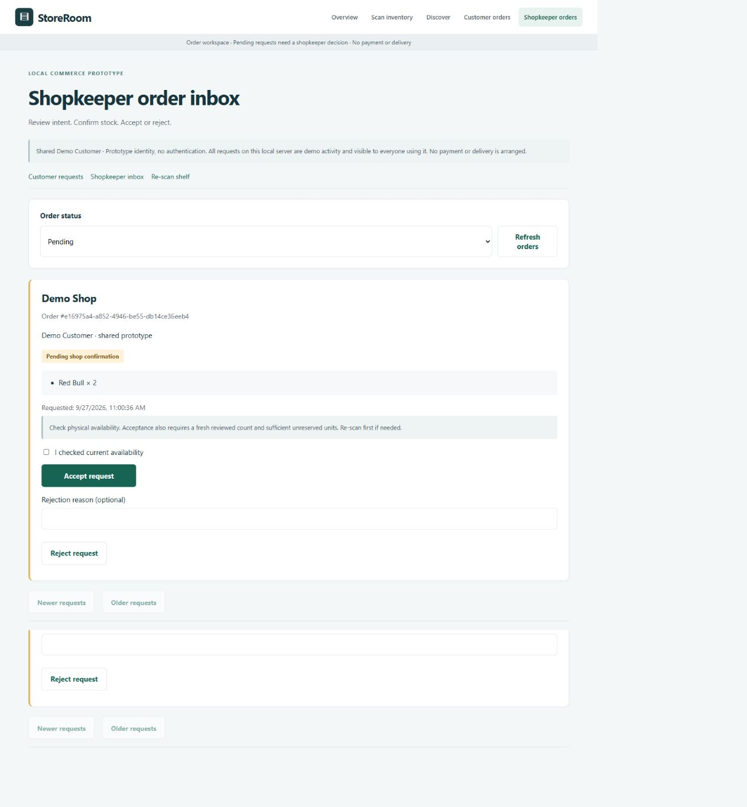
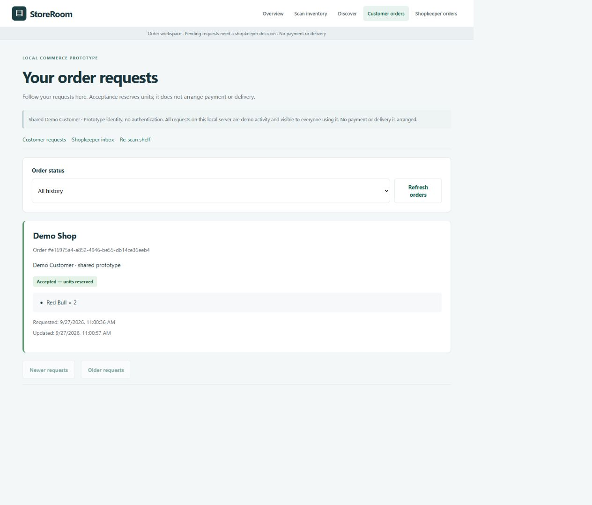

# StoreRoom

**AI-powered hyperlocal retail inventory and ordering platform.**

Turn a shelf photo into structured, human-reviewed inventory. Let customers discover products and send order requests to a participating local shop.

   

A personal full-stack project connecting computer vision, persistent evidence, inventory discovery and transactional order decisions. **Current scope: one local demo shop, five product classes, shared demo customer.** No real-world scale or live-stock claim.

## Product Demo



**Shopkeeper:** upload shelf → inspect AI detections → correct counts → confirm inventory.

**Customer:** search product → check shop availability and freshness → request quantity → receive acceptance or rejection.

| Review the shelf | Discover recorded availability |
|---|---|
|  |  |

| Shopkeeper inbox | Customer order status |
|---|---|
|  |  |

[Five-minute walkthrough](docs/PORTFOLIO_DEMO.md) · [All screenshots](src/web/screenshots/) · [Architecture](docs/ARCHITECTURE.md) · [Engineering decisions](docs/ENGINEERING_DECISIONS.md)

Captures are from the actual app using an [attributed public validation photo](docs/demo/ATTRIBUTION.md). Orders are local demo interactions, not customer/business results. Screenshots are not an independent CV benchmark.

## What I built

- Shelf-image detection with frozen YOLO11n and a reusable inference API.
- Human-reviewed quantities, persistent scan history, original images and prediction evidence.
- Stable product catalog IDs, inventory, customer search and fresh/stale/unknown states.
- Explicit catalog alternatives with conservative handling of missing preference metadata.
- Order requests, acceptance/rejection, customer status and pending cancellation.
- Atomic inventory reservations, retry-safe requests and database constraints.
- Validated local backup/restore for database and image evidence together.
- Automated API, database, concurrency, backup, browser and frozen-artifact tests.

## Quick Start

**Artifact requirement:** a fresh Git clone does **not** include the trained checkpoint. Restore `runs/augmentation_001/weights/best.pt` from preserved project artifacts first; expected SHA-256: `099b96ecd3cb440991b56c69cd243770ca499b8e246fee994ced3e24b93ec1c4`. There is no public model-download service configured. Screenshots/docs are available without setup. See [artifact restoration](docs/REPRODUCIBILITY.md).

Recorded environment: Windows, Python 3.14; CPU pins target that environment. From the repository root:

```powershell
python -m venv .venv
.\.venv\Scripts\python.exe -m pip install -r requirements-cpu.txt
.\.venv\Scripts\python.exe -m pip install -r requirements-api.txt
powershell -NoProfile -File scripts/run_demo.ps1
```

On an already configured checkout, only the last command is needed. It starts the existing backend and static frontend together, initializes separate demo storage and seeds labelled alternative relationships. It does not invent confirmed quantities or predictions. No secrets or `.env` are required.

| Browser | URL |
|---|---|
| Overview | http://127.0.0.1:8001/static/overview.html |
| Shopkeeper scan/history | http://127.0.0.1:8001/ |
| Discovery/inventory | http://127.0.0.1:8001/customer |
| Shopkeeper inbox | http://127.0.0.1:8001/shopkeeper/orders |
| Customer orders | http://127.0.0.1:8001/customer/orders |
| API docs | http://127.0.0.1:8001/docs |

Upload `docs/demo/shelf.jpg`, review its actual predictions, then confirm before trying orders. Seeded example quantities alone cannot authorize orders. The [walkthrough](docs/PORTFOLIO_DEMO.md) produces pending, accepted and rejected requests through the real UI. Data persists under ignored `outputs/portfolio-demo/`; Ctrl+C stops the server.

For the original local database and port, in a separate shell:

```powershell
.\.venv\Scripts\python.exe -m uvicorn src.api:app --host 127.0.0.1 --port 8000
```

There is **no frontend build**, npm install or second server. Optional settings: `STOREROOM_DB_PATH` (default `data/storeroom.db`), `SCAN_STORAGE_DIR` (default `data/scans`), `INVENTORY_FRESHNESS_SECONDS` (default 3600). Keep this unauthenticated demo on loopback. If a port is busy, use the running instance or stop it before starting another.

## Technical stack

| Layer | Actually used |
|---|---|
| Frontend | Semantic HTML, CSS, plain JavaScript, Fetch API |
| Backend | Python, FastAPI, Pydantic, Uvicorn |
| Persistence | SQLAlchemy, SQLite, local image evidence |
| AI | Ultralytics YOLO11n, PyTorch CPU, OpenCV; Supervision for dataset conversion |
| Engineering | Git, unittest, Playwright tests, checksummed artifacts, backup/restore CLI |

No React/TypeScript, Docker, PostgreSQL, Redis or cloud deployment. The [architecture diagram](docs/ARCHITECTURE.md) maps current responsibilities to source files.

## Engineering highlights

**Prediction ≠ inventory.** Corrections preserve original photos, boxes and model counts. Only reviewed observations update inventory.

**Acceptance is transactional.** Pending requests reserve nothing. A SQLite write transaction rechecks freshness and every item before acceptance. Accepted items reserve quantities without rewriting shelf evidence.

**Freshness is explicit.** Timestamped observations are estimates, not real-time stock. Stale and seeded quantities cannot authorize acceptance.

**Evidence survives recovery.** Backups include SQLite plus referenced photos, checksums and schema validation. Restore retains previous data for rollback.

**Alternatives have evidence.** Explicit relationships and known metadata determine suggestions. Missing ingredients do not become a dietary guarantee.

Read the [tradeoffs and failure cases](docs/ENGINEERING_DECISIONS.md): concurrent acceptance, idempotency, stale data and evaluation leakage.

## Current AI limitations

Five supported source classes: **Red Bull, Knoppers Riegel, Valser Classic, Valser Still, Capri-Sun Multivitamin**. This is not production-scale Indian retail recognition. Counts cover visible packages only; exact pack sizes, hidden stock and independent field generalization are unverified.

Historical validation: precision **0.791**, recall **0.888**, counting MAE **0.423**, exact five-class counts **11/26 images**. These are existing validation results, not independent field metrics. Both Valser classes regressed against the preceding model. See [augmentation evidence](reports/AUGMENTATION_001_RESULTS.md), [independence audit](reports/INDEPENDENT_VALIDATION_001_RESULTS.md) and [V0.1 summary](reports/V0_1_RESULTS.md). No results were changed for this presentation.

Commerce limits: one demo shop; shared identity; no authentication, geolocation, payments or delivery. Accepted reservations have no fulfillment/release workflow. The opt-in alternative pair is Valser Classic/Still, with unverified equivalence. No verified ingredient enrichment or medical recommendations.

## Tests and recovery

On the artifact-complete checkout:

```powershell
.\.venv\Scripts\python.exe -m pip install -r requirements-ui-test.txt
.\.venv\Scripts\python.exe -m playwright install chromium
$env:STOREROOM_DB_PATH = 'outputs/test-runtime/storeroom.db'
$env:SCAN_STORAGE_DIR = 'outputs/test-runtime/scans'
.\.venv\Scripts\python.exe -m unittest discover -s tests -v
```

Isolated paths avoid locking the demo database. Full tests require restored research artifacts; a source-only clone cannot pass them. No training or protected test-set inference is needed. The [presentation report](reports/PORTFOLIO_PRESENTATION_RESULTS.md) records the latest checks.

See [backup/restore](docs/V0_6_BACKUP_RESTORE.md) and the [isolated recovery demo](docs/PORTFOLIO_DEMO.md#recovery-demonstration). Databases, private field photos, environments, backups and weights are Git-ignored.

## Roadmap

**Current:** end-to-end local MVP.

**Next:** independent field validation, verified Indian product data, broader catalog and a supervised real-store pilot.

**Later:** marketplace/delivery and production infrastructure when justified.

V1.1 [dataset audit](reports/V1_1_DATASET_AUDIT.md) and [recognition design](docs/V1_1_INDIAN_RETAIL_RECOGNITION.md) are complete; implementation is blocked on data verification. [Detailed roadmap](ROADMAP.md).

## Repository guide

`src/` application and experiment code · `src/web/` browser UI · `tests/` automated checks · `configs/` frozen profiles · `docs/` setup/design · `reports/` evidence · `scripts/` local helpers.

Historical V0.1–V1.0 reports remain unchanged. [Reproducibility](docs/REPRODUCIBILITY.md) records provenance and hashes. No project-wide license has been added; dependency, model and dataset terms apply separately. Demo-photo attribution accompanies the asset.
