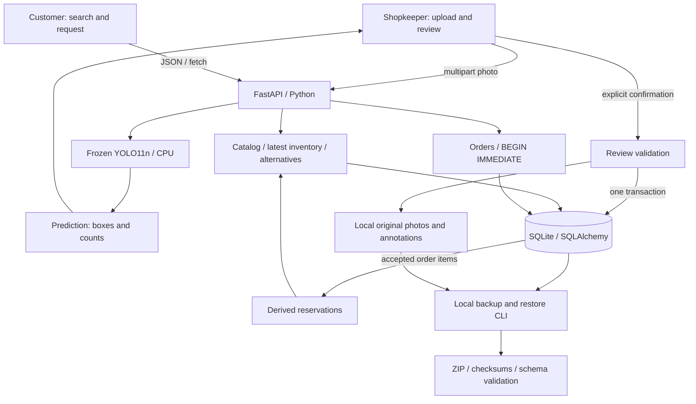

# StoreRoom architecture

One local FastAPI application serves both the browser UI and API. The frontend is HTML, CSS and plain JavaScript, not React. There is no separate frontend build, queue, cloud service or database server.

## Boundaries in the code

| Responsibility | Implementation | Contract |
|---|---|---|
| Browser presentation | `src/web/` | Existing scan, discovery and order routes; static overview |
| HTTP validation/lifecycle | `src/api.py` | Pydantic requests; one detector loaded at startup |
| Inference | `src/inference/`, `src/class_confidence_predictor.py` | Frozen checkpoint hash and pre-NMS class confidence policy |
| Review + evidence | `src/review.py`, `src/storage.py`, `src/evidence.py` | Server-held prediction is distinct from human-confirmed quantities |
| Catalog/inventory | `src/catalog.py` | Five stable source-product IDs, one demo shop, latest explicitly reviewed counts |
| Alternatives | `src/alternatives.py` | Explicit relationships; unknown metadata does not pass restrictive filters |
| Orders | `src/orders.py` | Pending → accepted/rejected/cancelled; atomic checks and derived reservations |
| Persistence | `src/migrations.py` | Additive SQLite schemas, currently version 4 |
| Recovery | `src/backup.py`, `src/data_lock.py`, `src/data_cli.py` | SQLite snapshot + referenced files; cooperative locks; validate before restore |

## Data ownership

Scans own original predictions and corrected observations. Catalog products own stable IDs, names and known metadata. Shop inventory references the source scan and confirmation timestamp. Orders retain product/shop name snapshots. Accepted order items form the reservation ledger: there is no separate quantity-decrement job.

`available = max(0, latest reviewed quantity - accepted reservations)`.

A later scan does not erase reservations. A shortfall is displayed; fulfillment and reservation release are not implemented. Pending orders reserve nothing. Acceptance checks freshness and all requested quantities within a SQLite write transaction. This prevents two cooperating requests from reserving the same remaining units.

## Actual routes

| Browser | Purpose |
|---|---|
| `/static/overview.html` | Portfolio entry point |
| `/` | Existing scan/review/confirmation/history workspace |
| `/customer` | Search, inventory freshness, alternatives, request form |
| `/customer/orders` | Shared demo customer's status/history |
| `/shopkeeper/orders` | Shopkeeper decisions |
| `/docs` | FastAPI API documentation |

There is no separate shopkeeper inventory page; confirmed inventory is visible through discovery. There is no authentication or geolocation-based nearby-store search. Keep this unauthenticated prototype on loopback. See [engineering decisions](ENGINEERING_DECISIONS.md) and [demo guide](PORTFOLIO_DEMO.md).
